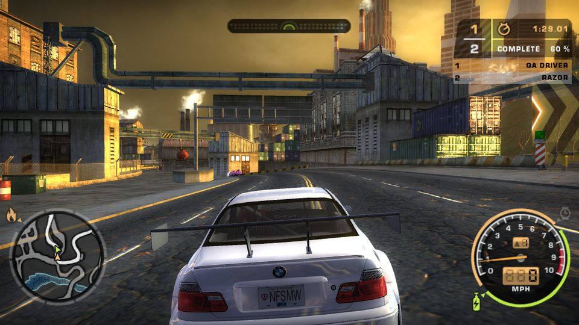

# NFS Most Wanted (2005) — Unity rebuild

A from-scratch rebuild of **Need for Speed: Most Wanted** (2005, PC) in Unity, written by reverse-engineering the
original `speed.exe` (v1.3) function by function. It runs on **your own installed copy of the game**: Rockport, the
cars, the menus, the career scripts, the sounds and the cutscenes are read from the game folder while it runs.

**No game content is in this repository** — no textures, models, audio, music, video, data files or executable. You
need your own copy of Need for Speed: Most Wanted (PC).

**Website:** https://magicibrar.github.io/nfsmw-unity/ (what works, how it was built, setup and modding).

## Status

- **98 % of the game's code ported** (effective, measured over speed.exe's 2.35 MB of game code; 80 % ported
  function for function, the rest partial, nothing missing). See [`NFSMW_RE/coverage/coverage.md`](NFSMW_RE/coverage/coverage.md).
- A playable offline career from the press-start screen to the Blacklist: races, pursuits, the safehouse, car lot,
  customization, the Challenge Series, split screen and LAN.
- 9 automated play tests and a 55-shot screenshot tour pass on every build.

Details per feature: [`NFSMWUnity/README.md`](NFSMWUnity/README.md). How each file format and system was reversed:
[`NFSMW_RE/REPORT.md`](NFSMW_RE/REPORT.md) and the specs in [`NFSMW_RE/specs`](NFSMW_RE/specs).

## Point it at your game

The rebuild needs the installed game folder: the one that contains `GLOBAL`, `TRACKS`, `CARS`, `FRONTEND` and
`speed.exe`. It looks for it in this order:

1. `-gameRoot "D:\Games\Need for Speed Most Wanted"` on the command line
2. a file named `gameroot.txt` next to the player exe (or next to `Assets` in the editor) holding that path
3. the `NFSMW_ROOT` environment variable
4. the retail default, `C:\Program Files (x86)\EA GAMES\Need for Speed Most Wanted`

The rebuild targets the **v1.3** data (the patched retail game). It only reads the folder; it never writes to it.

## Build and run

1. Install **Unity 6000.4.2f1** (Unity Hub) and, for the tools, the **.NET 8 SDK**.
2. Clone this repository and open `NFSMWUnity` in Unity.
3. Create `NFSMWUnity/gameroot.txt` with your game path (see above).
4. Open `Assets/Scenes/FreeRoam.unity` and press Play, or build with `NFSMW > Build Windows Player` (or
   `./batch.sh NFSMWBuild.BuildWindows build` from Git Bash). Put a `gameroot.txt` next to the built
   `NFSMWUnity.exe` too.

Controls, split screen and LAN are described in [`NFSMWUnity/README.md`](NFSMWUnity/README.md).

## Modding

Export the game's textures (PNG) and models (OBJ), edit them, and drop the results into a `Mods` folder; the rebuild
loads them instead of the originals. Your game files are never changed. See [`MODDING.md`](MODDING.md).

## Repository layout

| Folder | What |
|---|---|
| `NFSMWUnity/Assets/NFSMW/Core` | Unity-free readers and game logic: file formats, the attribute database, a Lua 5.0 VM, the AEMS sound-script VM, audio codecs, physics and AI maths |
| `NFSMWUnity/Assets/NFSMW/Runtime` | The game on Unity: world streaming, rendering, cars, physics, AI, police, career, front end, HUD, audio |
| `NFSMWUnity/Assets/NFSMW/Shaders` | Ports of the game's 31 D3D effects |
| `NFSMWStaging/Harness` | .NET probes that check the readers against the game data without Unity |
| `NFSMWStaging/ModTool` | The texture/model export and import tool |
| `NFSMW_RE` | Reverse-engineering notes: per-system specs with exe addresses, and the code coverage report |

## Legal

This is a non-commercial fan project for preservation and study. It is not affiliated with or endorsed by Electronic
Arts. Need for Speed and Need for Speed: Most Wanted are trademarks of Electronic Arts Inc. The code here is MIT
licensed (see [`LICENSE`](LICENSE)); the game and all of its content remain the property of their owners and are not
distributed here. Please do not open issues or pull requests that contain game files or content extracted from them.
